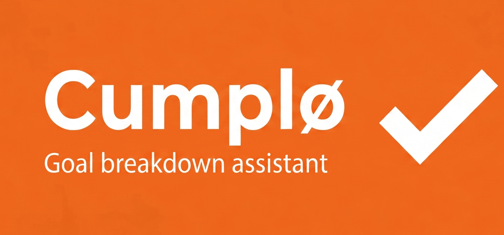

<p align="center">
  
</p>

# Cumplø

Cumplø es una herramienta local, sin nube, para descomponer **proyectos** en **tareas** y **subtareas** accionables usando un modelo de lenguaje ejecutado en este mismo equipo a través de [Ollama](https://ollama.com). Forma parte de una suite local-first orientada a trabajo profesional, planificación y productividad con IA local.

**Versión: 0.8.1-beta** · Beta pública.

## Filosofía

- Funcionamiento totalmente local. Tus proyectos, tareas y subtareas no salen del equipo.
- HTML, CSS y JavaScript puro. Sin frameworks, sin CDN, sin build.
- Sin cookies, sin analítica, sin telemetría.
- El estado se guarda en `localStorage` y solo en este navegador; el modo efímero permite trabajar sin persistir proyectos.
- Servidor local `server.py` que solo escucha en `127.0.0.1` con cabeceras de seguridad endurecidas (CSP, Permissions-Policy, COOP, CORP) y validación de Host (mitigación DNS rebinding).
- La CSP restringe `connect-src` exclusivamente al origen propio y a `http://localhost:11434` / `http://127.0.0.1:11434` (Ollama). Cumplø no puede llamar a ningún otro servidor.
- La respuesta del modelo se trata como entrada **no confiable**: se parsea, normaliza, recorta longitudes, se acota la profundidad jerárquica y nunca se inserta como HTML.

## Modelo funcional

Cumplø utiliza una jerarquía deliberadamente simple:

```text
Proyecto
├── Tarea
│   ├── Subtarea
│   └── Subtarea
└── Tarea
    └── Subtarea
```

No pretende sustituir a un gestor de proyectos complejo. Su función es convertir un objetivo amplio en una estructura de trabajo clara, editable y exportable.

## Funcionalidades principales

- **Gestión local de proyectos**: listado lateral de proyectos guardados, búsqueda, selección, renombrado, duplicado, archivado, restauración y eliminación.
- **Persistencia de varios proyectos** en `localStorage`, con migración automática desde el esquema anterior de plan único.
- Escala de desglose **1–5** para ajustar la granularidad.
- **Desglose por rama**: botón "Desglosar más" en tareas principales para generar subtareas adicionales.
- **Emoji por tarea/subtarea** asignado por el modelo a partir de una lista cerrada.
- **Filtro por emoji** y **buscador por texto** sobre tareas y subtareas.
- **Toggle "Ocultar completadas"**.
- **Edición inline** de la descripción de cada tarea o subtarea.
- **Detección dinámica de modelos**: Cumplø descubre los modelos descargados en Ollama y permite elegir el activo.
- **Indicador de estado de Ollama** en la cabecera y panel de diagnóstico con origen actual, modelos detectados y valor recomendado de `OLLAMA_ORIGINS`.
- **Botón Apagar** que detiene el servidor local desde la propia interfaz.
- **Atajo de teclado**: `Ctrl + Enter` en el textarea para descomponer el proyecto activo.
- **Bilingüe ES / EN**, con conmutador y persistencia de idioma.
- **Stylesheet de impresión** para sacar el proyecto en papel sin botones ni paneles auxiliares.
- Exportación del proyecto actual a Markdown o JSON.
- Exportación de toda la biblioteca de proyectos a JSON.
- Importación de proyectos desde JSON sin sobrescribir los ya existentes.
- **Perfiles**: general, personal, trabajo, investigación doctoral, eventos, formación, archivo y documentación.
- **Modo efímero**: borra la biblioteca persistida y conserva los cambios solo en memoria hasta cerrar o recargar la pestaña.
- **Cancelación de generación**: durante una llamada a Ollama, el botón principal permite abortar la petición.

## Arranque

| Sistema | Comando |
|---|---|
| Windows | doble clic en `start.bat` |
| macOS | `./start.sh` |
| Linux  | `./start.sh` |

El primer arranque solo levanta el servidor local en `127.0.0.1:8765` y abre el navegador. **Cumplø no arranca ni configura Ollama**: Ollama debe estar instalado y corriendo por su cuenta.

**Antes del primer uso**: configura `OLLAMA_ORIGINS` para permitir el origen `http://127.0.0.1:8765`. Es un ajuste único por equipo y está documentado paso a paso en [`docs/INSTALAR-OLLAMA.es.md`](docs/INSTALAR-OLLAMA.es.md).

## Requisitos

- **Python 3.8+** para servir los ficheros estáticos (`server.py`).
- **Ollama** instalado, corriendo y con `OLLAMA_ORIGINS` configurado.
- Al menos un modelo descargado en Ollama.

## Esquema de proyecto exportado

```json
{
  "schema_version": "cumplo.project.v2",
  "app_version": "0.8.1-beta",
  "exported_at": "2026-05-12T00:00:00.000Z",
  "project": {
    "id": "project_...",
    "title": "string",
    "summary": "string",
    "category": "string corta",
    "difficulty": "low | medium | high",
    "estimated_total_time": "string",
    "status": "active | archived",
    "created_at": "ISO-8601",
    "updated_at": "ISO-8601",
    "tasks": [
      {
        "id": "task_...",
        "title": "string",
        "emoji": "string (un solo emoji)",
        "description": "string",
        "estimated_time": "string",
        "energy": "low | medium | high",
        "done": false,
        "subtasks": [
          {
            "id": "subtask_...",
            "title": "string",
            "emoji": "string (un solo emoji)",
            "description": "string",
            "estimated_time": "string",
            "energy": "low | medium | high",
            "done": false,
            "subtasks": []
          }
        ]
      }
    ]
  }
}
```

Cumplø es tolerante con proyectos que no traigan `emoji`, `category`, `status` o metadatos temporales: asigna valores por defecto. La profundidad funcional admitida es **dos niveles bajo proyecto**: tareas y subtareas. Los identificadores internos de proyectos, tareas y subtareas se verifican y se regeneran cuando faltan, son inválidos o están duplicados.

## Seguridad (endurecida hasta 0.8.1-beta)

- Servidor solo en `127.0.0.1` (no expuesto a la red).
- **Validación de Host** en todas las respuestas: mitiga DNS rebinding.
- Cabeceras enviadas por HTTP **y** duplicadas en `<meta>` del HTML:
  - `Content-Security-Policy` estricta (`default-src 'self'`, `connect-src` limitado a Ollama, **sin `'unsafe-inline'`** en `style-src` ni `script-src`).
  - `Permissions-Policy` sin permisos sensibles (camera, geolocation, etc.).
  - `X-Content-Type-Options: nosniff`.
  - `Referrer-Policy: no-referrer`.
  - `Cross-Origin-Opener-Policy: same-origin`.
  - `Cross-Origin-Resource-Policy: same-origin`.
- Endpoints internos (`/__cumplo_health`, `/__cumplo_shutdown`) verifican `Origin` o `Sec-Fetch-Site` para mitigar CSRF.
- Validación regex del nombre de modelo antes de cualquier llamada a Ollama.
- Timeouts y cancelación explícita en llamadas a Ollama (`AbortController`): 2.5 s para detección, 180 s para generación.
- Parseo defensivo del JSON del modelo: longitudes recortadas, número de proyectos/tareas limitado, profundidad acotada a tareas/subtareas, identificadores únicos, sin renderizado como HTML.
- `localStorage` con `try/catch` y modo efímero para evitar persistencia de proyectos.
- Límite de importación JSON de 2 MB para evitar bloqueos del navegador por ficheros excesivos.
- Header `Server:` sin versión específica (reduce fingerprinting).

## Limitaciones

- No tiene sincronización entre dispositivos.
- No hay base de datos ni autenticación.
- No incluye adjuntos.
- No hay calendario, dependencias formales, fechas límite ni asignación multiusuario.
- La calidad del desglose depende del modelo local.

## Estructura del repositorio

```text
cumplo/
├── index.html
├── styles.css
├── prompts.js        # prompts bilingües para proyecto/tareas/subtareas
├── ollama.js         # window.CumploOllama: detect, chat, setActiveModel
├── app.js            # estado, render, handlers, normalización y biblioteca de proyectos
├── i18n.js           # motor de traducciones inline ES/EN
├── server.py         # servidor local con seguridad endurecida
├── start.sh          # arranque Linux/macOS
├── start.bat         # arranque Windows
├── LICENSE           # MIT
├── SECURITY.md
├── README.md
├── CHANGELOG.md
├── assets/
│   ├── cumplo-logo.svg
│   ├── cumplo-brand.png
│   ├── cumplo-banner.png
│   └── cumplo-favicon.png
├── docs/
│   └── INSTALAR-OLLAMA.es.md
└── examples/
    └── ejemplo-proyecto.json
```

## Suite local-first

Cumplø es la pieza de **descomposición de proyectos en tareas accionables** de la suite. Las otras piezas:

- **Compo**: composición/asistencia documental local.
- **Pomo**: motor local de evaluación previa al tratamiento documental.
- **Velo**: detección y redacción de datos sensibles en PDF.
- **PlumA**: asistente de descripción archivística.

Todas comparten: arquitectura local, sin telemetría, sin nube, CSP estricta y conexión exclusiva a Ollama local.

## Licencia

[MIT](LICENSE) — Copyright (c) 2026 Víctor Villapalos Pardiñas.
